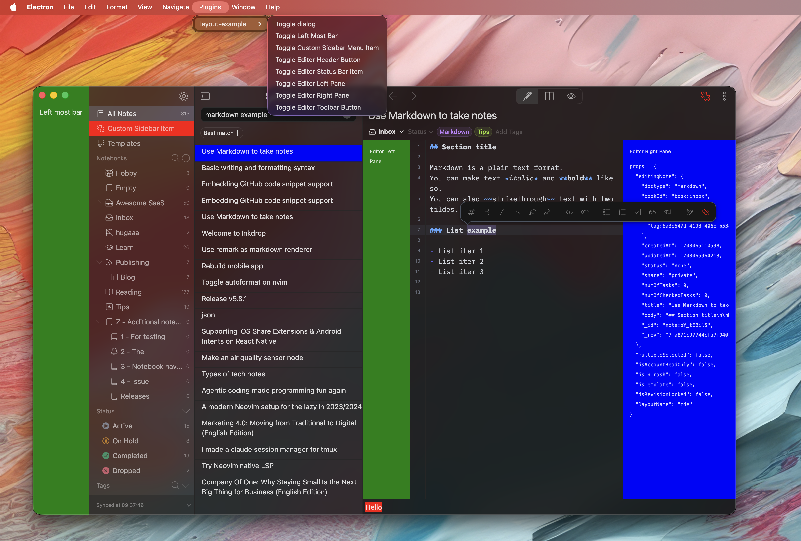

> [!IMPORTANT]
> This repository has moved to [inkdropapp/plugins](https://github.com/inkdropapp/plugins): [`packages/layout-example`](https://github.com/inkdropapp/plugins/tree/main/packages/layout-example). It is archived and read-only; please open issues and pull requests there.

# Inkdrop Extending Layout Example Plugin

A reference plugin for Inkdrop showing every way to put your own React components
into the app's UI — bars, editor panes, a sidebar item, a toolbar button, a status bar
item, a dialog, and a replacement for the note list item view.



It accompanies the [Extending the UI](https://developers.inkdrop.app/guides/extend-the-ui)
guide. The full set of layouts you can target is listed in
[Layouts](https://developers.inkdrop.app/states/layouts).

## Try it

This plugin is not published to the plugin registry — it's meant to be cloned, read, and
run locally:

```sh
git clone https://github.com/inkdropapp/layout-example-plugin.git
cd layout-example-plugin
pnpm install
pnpm build
ipm link --dev
```

`ipm link --dev` symlinks the directory into Inkdrop's `dev/packages`, so it won't
disturb your installed plugins. Reload the app afterwards to pick it up.

## How to use

Toggle each component from the menu: _Plugins_ → _layout-example_ → …

## What each example shows

| Example                    | Layout              | Source                           |
| -------------------------- | ------------------- | -------------------------------- |
| Dialog opened by a command | `modal`             | `src/message-dialog.tsx`         |
| Bar left of the sidebar    | `main:full`         | `src/left-most-bar.tsx`          |
| Sidebar menu item          | `sidebar-menu`      | `src/sidebar-menu-item.tsx`      |
| Pane left of the editor    | `mde`               | `src/editor-left-pane.tsx`       |
| Pane right of the editor   | `mde`               | `src/editor-right-pane.tsx`      |
| Editor header button       | `editor-header`     | `src/editor-header-button.tsx`   |
| Editor toolbar button      | `editor-toolbar`    | `src/editor-toolbar-button.tsx`  |
| Editor status bar item     | `editor-status-bar` | `src/editor-status-bar-item.tsx` |
| Custom note list item view | —                   | `src/note-list-item-view.tsx`    |

The note list item view isn't placed in a layout: it's registered under the reserved
component name `CustomNoteListItemView`, which the note list renders in place of its
built-in row.

Three supporting modules are worth reading too:

- `src/index.ts` — the plugin's `activate(env)` / `deactivate(env)` entry point.
- `src/env.ts` — captures the `Environment` handed to `activate()` so the rest of the
  plugin can reach it without the discouraged global `inkdrop`.
- `src/app-components.tsx` — borrows `Button`, `SideBarMenuItem`, and `StreamlineIcon`
  from the app's component registry.

## Development

```sh
pnpm dev        # rebuild lib/ on change
pnpm typecheck
pnpm lint
pnpm format
```

The plugin is written in TypeScript, bundled with [tsdown](https://tsdown.dev/), typed
with [`@inkdropapp/types`](https://github.com/inkdropapp/types), and checked with
[oxlint](https://oxc.rs/docs/guide/usage/linter) and
[oxfmt](https://oxc.rs/docs/guide/usage/formatter).
